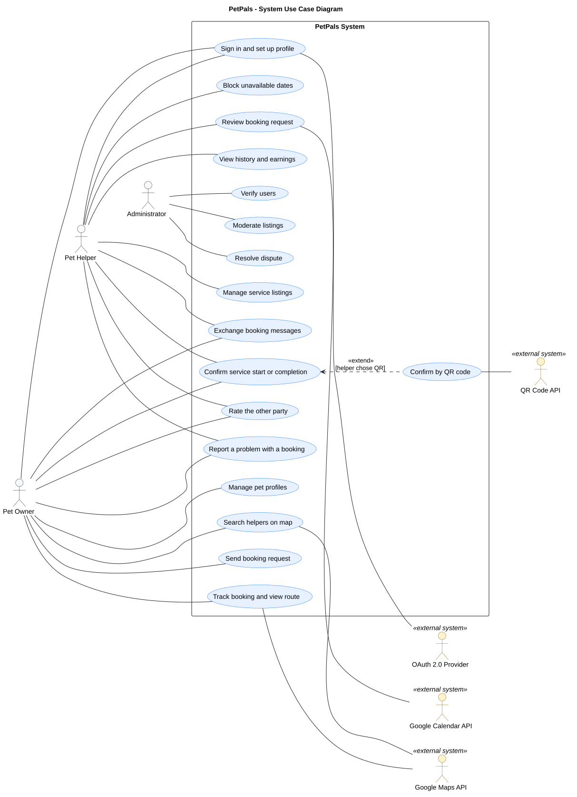

# 3. Use Cases

**Objective:** Show the principal interactions between the application's actors and the system. Describe how an actor achieves a goal and what happens when an important step fails. Base the interactions on the approved requirements and revise them as the application develops.

## 3.1 Use Case Diagram
**Objective:** Show the system boundary, its relevant actors, and their main goals in **one readable UML use case diagram**. Add a focused second diagram only if the complete view cannot remain clear; a third requires a distinct project-specific reason.
**Rendered use case diagram:**   
**Versioned PlantUML source:** [`Source puml`](./puml/3-1-petpals-system-UC.puml)

The diagram shows the three roles that interact with PetPals. Pet Owner and Pet Helper use the mobile application and share a generalized actor, Registered User, for goals both can perform (signing in, confirming a service, messaging, rating, reporting a problem). The Administrator uses the web administration panel only. External systems appear as secondary actors where they take part in a user goal: the OAuth 2.0 provider during sign-in, Google Maps during search and route display, Google Calendar when a helper approves a request, and the QR Code API when a service is confirmed by QR code. QR confirmation is modelled as an `<<extend>>` of the general confirmation use case because the helper chooses between QR code and button for each confirmation.
**Consistency check:** Show the identified roles that **interact with the application**, not stakeholders who have no interaction. Each main user goal must have an associated actor; an included use case can be reached through another use case without its own direct actor association. Use `<<include>>` and `<<extend>>` only when the relationship expresses actual behavior.
---

## 3.2 Use Case Descriptions
**Objective:** For each use case in the diagram, explain the actor's goal, the normal interaction with the application, and meaningful alternatives. Describe straightforward use cases briefly; expand those whose alternatives, external dependencies, or consequences require more explanation.

### UC-001: Sign in and set up profile

| Field | Description |
| --- | --- |
| Primary actor | Pet Owner or Pet Helper; secondary actor: OAuth 2.0 provider |
| Requirement ID(s) | F-001 |
| Preconditions, if any | None. |
| Main flow | 1. The user chooses to sign in with an external provider (for example Google). 2. The provider authenticates the user and returns their identity to the application. 3. On first sign-in the application asks the user to choose a role (Pet Owner or Pet Helper) and to enter a minimal profile: first name, last name and, optionally, a photo. 4. The user submits the profile; the application creates the account marked "pending verification". |
| Alternative or failure flows, if any | **2a — Authentication fails or is cancelled:** the user stays signed out and the application explains how to retry. **3a — Name missing:** the application asks for it before continuing. |
| Result | The user is signed in. Until an Administrator approves the account (UC-015), an owner can browse and prepare bookings but cannot send requests, and a helper can prepare service listings but cannot receive requests. |

### UC-002: Manage pet profiles

| Field | Description |
| --- | --- |
| Primary actor | Pet Owner |
| Requirement ID(s) | F-002 |
| Preconditions, if any | The owner is signed in. |
| Main flow | 1. The owner opens their pets and chooses to add a pet. 2. The owner enters the name, species, optional breed, birth date, a short free-text note (for example medication or fears) and a photo. 3. The owner saves; the application stores the pet profile. |
| Alternative or failure flows, if any | **3a — Required fields missing:** the application highlights them and does not save. **Edit or delete:** the owner can edit a saved pet profile or delete it; a deleted pet no longer appears in the list, and existing bookings keep the care notes saved at booking time. |
| Result | The pet profile exists and can be chosen when sending a booking request. It is visible only to the owner and to a helper who receives a booking request for that pet. |

### UC-003: Manage service listings

| Field | Description |
| --- | --- |
| Primary actor | Pet Helper |
| Requirement ID(s) | F-011 |
| Preconditions, if any | The helper is signed in. |
| Main flow | 1. The helper chooses to add a service listing. 2. The helper selects the service type (sitting, walking or feeding) and enters a description, a rate (for example per hour or per day), a photo and the service location. 3. The helper sets the availability calendar of the listing and saves. 4. The application stores the listing as a bookable, searchable entity with type, price, availability and location. |
| Alternative or failure flows, if any | **4a — Helper not yet verified:** the listing is saved but cannot receive booking requests until the helper is verified (UC-015). **4b — Listing removed by an Administrator:** the listing is hidden from search and the helper is shown that it was removed (UC-016). **Edit or delete:** the helper can edit or delete a listing; a deleted listing no longer appears in search. |
| Result | The listing appears in search results for matching owners, subject to the helper's verified status. |

### UC-004: Block unavailable dates

| Field | Description |
| --- | --- |
| Primary actor | Pet Helper |
| Requirement ID(s) | F-012 |
| Preconditions, if any | The helper has at least one service listing. |
| Main flow | 1. The helper opens the calendar of a listing. 2. The helper selects dates on which they are unavailable and confirms. 3. The application marks the dates as blocked. |
| Alternative or failure flows, if any | None. |
| Result | Blocked dates do not appear in search results for that listing and cannot be booked. |

### UC-005: Search helpers on map

| Field | Description |
| --- | --- |
| Primary actor | Pet Owner; secondary actor: Google Maps API |
| Requirement ID(s) | F-003, F-004 |
| Preconditions, if any | The owner is signed in (verified or not). |
| Main flow | 1. The owner enters a location, either the current location or a point chosen on the map, selects a service type and a date range, and optionally a price range. 2. The application returns the matching helpers as a list and as markers on an interactive map. 3. The owner selects a marker; the application shows a summary card with the helper's services, rates, average rating and availability for the requested period. |
| Alternative or failure flows, if any | **1a — Current location unavailable:** the owner chooses a point on the map manually. **2a — No helper matches:** the application says so and the owner changes the criteria. |
| Result | The owner can open a helper's availability and send a booking request (UC-006). |

### UC-006: Send booking request

| Field | Description |
| --- | --- |
| Primary actor | Pet Owner |
| Requirement ID(s) | F-005 |
| Preconditions, if any | The owner is signed in; a helper was chosen (UC-005). |
| Main flow | 1. The owner opens the helper's availability calendar; available slots are highlighted, booked and blocked dates are greyed out. 2. The owner selects a service and a start and end date and time. 3. The owner chooses one of their pet profiles, enters the handover address and optionally adds a message. 4. The owner sends the request; the application creates a booking in the "Requested" state. 5. The owner can follow the request in their bookings list. |
| Alternative or failure flows, if any | **0a — Owner not yet verified:** the owner can prepare the booking but the application does not send it and explains that verification is pending. **3a — No pet profile exists:** the owner creates one first (UC-002) and returns to step 3. |
| Result | A booking in the "Requested" state awaits the helper's decision. |

### UC-007: Review booking request

| Field | Description |
| --- | --- |
| Primary actor | Pet Helper; secondary actor: Google Calendar API |
| Requirement ID(s) | F-006, F-007 |
| Preconditions, if any | The helper is verified and a booking request is in the "Requested" state. |
| Main flow | 1. The helper opens the request and sees the owner's profile, the pet profile, the owner's previous ratings and the requested date range. 2. The helper accepts the request. 3. The application locks the time slot for that listing and updates the booking status for the owner. 4. The application creates Google Calendar events for both parties with start time, end time, handover address and automatic reminders before both boundaries. |
| Alternative or failure flows, if any | **2a — Helper declines:** the owner sees the updated status; no slot is locked and no calendar events are created. **4a — Calendar events cannot be created:** the approval stays valid; after three failed attempts (NF-06) the application reports that the events were not created. |
| Result | The booking is approved, the slot is locked and both parties have calendar events. |

### UC-008: Track booking and view route

| Field | Description |
| --- | --- |
| Primary actor | Pet Owner |
| Requirement ID(s) | F-005 |
| Preconditions, if any | The owner has sent at least one booking request. |
| Main flow | 1. The owner opens their bookings list and selects a booking. 2. The application shows the booking status (Requested, Approved, In Progress or Completed) and the handover address. |
| Alternative or failure flows, if any | None. |
| Result | The owner knows the current status of the booking and where the handover takes place. |

### UC-009: Confirm service start or completion

| Field | Description |
| --- | --- |
| Primary actor | Pet Helper (initiates); Pet Owner (confirms) |
| Requirement ID(s) | F-008, F-009 |
| Preconditions, if any | The booking is Approved (to confirm the start) or In Progress (to confirm completion). |
| Main flow | 1. At the agreed time the helper initiates the confirmation and chooses the method: QR code when both parties are physically together, or a "Confirm" button for drop-in services where they are not. 2. The helper performs their side of the confirmation in the application. 3. The owner performs their side with the same method. 4. When both sides have confirmed, the booking moves to "In Progress" (start) or "Completed" (completion). |
| Alternative or failure flows, if any | **1a — QR method chosen:** see UC-010. **3a — Only one side confirms:** the booking does not advance. **3b — Confirmation is not given or is disputed:** either party can report a problem (UC-013). |
| Result | The booking state changes only after both parties confirmed. The confirmation events are kept in the booking record. |

### UC-010: Confirm by QR code

| Field | Description |
| --- | --- |
| Primary actor | Pet Helper (initiates); Pet Owner (confirms); secondary actor: QR Code API |
| Requirement ID(s) | F-008, F-009 |
| Preconditions, if any | A confirmation was initiated (UC-009) and the helper chose the QR method. |
| Main flow | 1. The application requests a unique QR image for the booking from the QR Code API and displays it. 2. The helper's application displays the QR code and the owner scans it with the application. 3. The application records both confirmations. |
| Alternative or failure flows, if any | **1a — QR image cannot be generated:** the application reports the failure and the helper can retry or choose the button method. |
| Result | The confirmation step is completed as in UC-009. |

### UC-011: Exchange booking messages

| Field | Description |
| --- | --- |
| Primary actor | Pet Owner or Pet Helper |
| Requirement ID(s) | F-017 |
| Preconditions, if any | A booking between the owner and the helper exists. |
| Main flow | 1. The user opens the chat of the booking. 2. The user writes and sends a text message. 3. The application delivers it to the other party within the same booking. |
| Alternative or failure flows, if any | None. |
| Result | The message is stored in the booking's chat log. It is visible only to the two parties and to the Administrator in case of a dispute. |

### UC-012: Rate the other party

| Field | Description |
| --- | --- |
| Primary actor | Pet Owner or Pet Helper |
| Requirement ID(s) | F-010 |
| Preconditions, if any | The booking is "Completed". |
| Main flow | 1. The application prompts the user to rate the other party. 2. The user selects a rating from 1 to 5 and may add a short review. 3. The user submits; the application stores the rating. |
| Alternative or failure flows, if any | **2a — Rating missing:** the application asks the user to select a value from 1 to 5. |
| Result | An owner's rating contributes to the helper's displayed average rating. A helper's rating of the owner influences whether other helpers accept that owner's future requests. |

### UC-013: Report a problem with a booking

| Field | Description |
| --- | --- |
| Primary actor | Pet Owner or Pet Helper |
| Requirement ID(s) | F-018 |
| Preconditions, if any | A booking with the status Approved, In Progress or Completed exists, for example after a no-show, a pet returned with an issue, or a disputed completion confirmation. |
| Main flow | 1. The user opens the booking and chooses to report a problem. 2. The user describes the problem and submits. 3. The application creates a dispute with the status Open for the booking; the booking status does not change. |
| Alternative or failure flows, if any | None. |
| Result | The dispute is available to the administrator (UC-017). |

### UC-014: View history and earnings

| Field | Description |
| --- | --- |
| Primary actor | Pet Helper |
| Requirement ID(s) | F-013 |
| Preconditions, if any | The helper is signed in. |
| Main flow | 1. The helper opens the history view. 2. The application lists the helper's completed bookings and shows the total earnings calculated from the rates and the completed bookings recorded in the system. |
| Alternative or failure flows, if any | **2a — No completed bookings:** the application shows an empty history and zero total. |
| Result | The helper sees recorded totals. The platform does not process payments; the figure is a display of recorded values. |

### UC-015: Verify users

| Field | Description |
| --- | --- |
| Primary actor | Administrator (web administration panel) |
| Requirement ID(s) | F-014 |
| Preconditions, if any | The Administrator is signed in to the panel and new profiles are waiting in the verification queue. |
| Main flow | 1. The Administrator opens the verification queue and selects a profile. 2. The Administrator reviews the submitted name and email. 3. The Administrator approves the profile; the application marks the user as verified. |
| Alternative or failure flows, if any | **3a — Administrator rejects the profile:** the profile is marked rejected and the user cannot send or receive booking requests. |
| Result | Only approved users can send or receive booking requests. Verified status is a visible attribute of the profile. |

### UC-016: Moderate listings

| Field | Description |
| --- | --- |
| Primary actor | Administrator (web administration panel) |
| Requirement ID(s) | F-015 |
| Preconditions, if any | The Administrator is signed in and a listing is inappropriate, illegal or misclassified (for example not really pet care). |
| Main flow | 1. The Administrator opens the listing. 2. The Administrator removes it. 3. The application hides the listing from search and shows the helper that the listing was removed. |
| Alternative or failure flows, if any | None. |
| Result | The removed listing no longer appears in search results. |

### UC-017: Resolve dispute

| Field | Description |
| --- | --- |
| Primary actor | Administrator (web administration panel) |
| Requirement ID(s) | F-016 |
| Preconditions, if any | A dispute is open for a booking (UC-013). |
| Main flow | 1. The Administrator opens the dispute. 2. The application shows the full record: the initial request, both parties' profiles and ratings, the complete chat log and the confirmation events. 3. The Administrator decides an outcome, such as an account warning, a temporary suspension or a recorded decision affecting the parties' future use of the platform. 4. The Administrator records the decision. |
| Alternative or failure flows, if any | None. |
| Result | The decision is recorded with the dispute. It is not financially executed because payment processing is out of scope. |

---

## 3.3 Use Case Consistency Check
**Objective:** Check that use cases, actors, and requirements agree with one another and with the application the team demonstrates.
| Check | Question for the team |
| --- | --- |
| Requirement | Does each important use case link to an existing requirement? |
| Actor | Does the actor here match an identified role and its permitted interaction? |
| Application | Can the team demonstrate the described main result and important alternative, or is the description marked as a current design? |

Maintain the requirement-to-use-case-to-test mapping **once, in the [requirement traceability table](./2-requirements.md)**.
