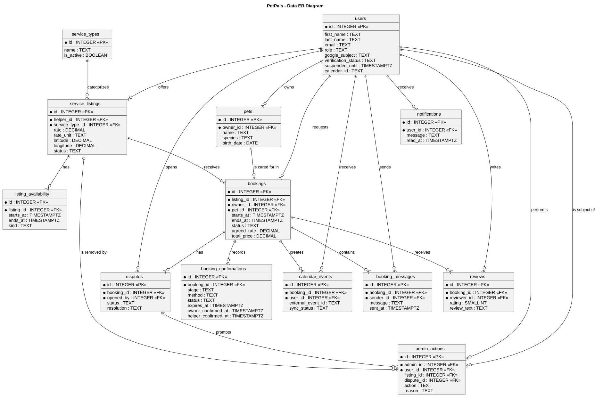
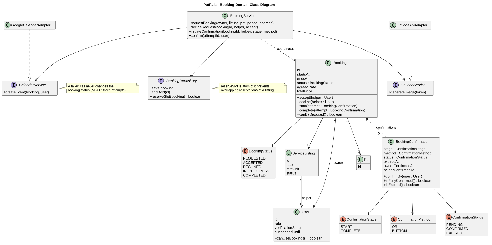

# 4. Architecture and Design

**Objective:** Design and explain the application's boundary, main choices, parts, data, and important behavior. Start with an architecture that guides implementation; revise it when design decisions change. At the final review, the descriptions and diagrams should explain the application that was actually built.

The page contains the **UML component, class, sequence, and state diagrams** and the data model. The use case diagram describes user goals; the deployment diagram shows where the finished application actually runs. Keep a readable image and versioned PlantUML source for each UML diagram, as described on [Home](./Home.md).

The expandable Crisis Guard examples illustrate a proposed design. Use your project's own decisions and models in the completed page.

| View | Main question |
| --- | --- |
| Solution strategy | Which architectural choices were made, and why? |
| Building blocks | What are the principal parts, their responsibilities, and their external connections? |
| Data and class design | What information is stored, and how is a representative part of the code structured? |
| Runtime behavior | How do parts collaborate, and how does a meaningful object change state? |
| Architectural decisions | Why was a consequential option chosen over alternatives? |
| Crosscutting concepts and risks | Which shared mechanisms and important compromises affect the design? |

## 4.1 Solution Strategy

**Objective:** Explain the few architectural choices that most affect the solution and their project-specific reasons.

| Decision | Alternative considered | Project-specific rationale and trade-off |
| --- | --- | --- |
|  |  |  |

Explain the main architectural choices without repeating the technologies list. If an important choice has an ADR, its ID in the table is enough.

<strong>Explaining a choice </strong>

**Example — Crisis Guard:**

| Decision | Alternative considered | Project-specific rationale and trade-off |
| --- | --- | --- |
| Browser client and one backend API | Several separately deployed backend services | The client displays the map while the backend validates and stores reports. One backend is manageable for this scope; its failure may interrupt report operations. See ADR-01 for the reasoning. |
| Relational storage for reports | Document-oriented storage | Reports have identifiable links to users and locations. A relational schema makes these relationships explicit but requires migrations when the schema changes. |

**Analysis of the example:** Both decisions state a reason tied to the reporting application and acknowledge a trade-off. The backend choice links to ADR-01 rather than repeating the full comparison. Modules within one deployable backend are not separate microservices. In your own table, include alternatives that the team genuinely considered.

## 4.2 Building Blocks and UML Component Diagram

**Objective:** Propose the principal parts of the application, assign their responsibilities, and show their dependencies without diagramming every file or class. Revise this view as the system takes shape.

**Component diagram:** [Embed a readable UML component diagram.]  
**PlantUML source:** [Link to the matching versioned `.puml` file.]

| Component | Responsibility | Reason for this boundary |
| --- | --- | --- |
|  |  |  |

Start by drawing the boundary around the proposed system. Inside it, identify parts with distinct responsibilities; put a planned application database inside this boundary and third-party services outside it. Label important connections with what crosses them. A logical component may be a module within one backend application: a separate box does not imply a separately deployed service. As you implement, update the diagram when responsibilities or connections change. In the final version, readers should be able to relate its parts to the code. The deployment diagram answers where those parts actually run.

<strong>System boundary, responsibilities, and external dependencies</strong>

**Example — Crisis Guard:** The proposed architecture supports report submission, a map view, and notifications about confirmed reports.

  
[PlantUML source](./puml/4-1-crisis-guard-system-CMP.puml)

| Part | Responsibility | Reason for this boundary |
| --- | --- | --- |
| Web client | Shows reports and collects a new report. | User interaction is separated from report rules and persistence. |
| Report API | Accepts report requests and returns responses. | HTTP-facing responsibilities are separated from report processing. |
| Report service | Applies report rules and accesses stored reports. | Report validation and storage rules have a clear owner. |
| Notification worker | Identifies eligible recipients and asks an external provider to send an alert. | Notification work is separate from answering a user's report request. |

**Analysis of the example:** The outer boundary distinguishes the proposed system from the map provider and the notification provider. The inner boundary groups the Report API, Report service, and Notification worker within one backend application; their separate symbols express proposed responsibilities, not independently deployed services. PostgreSQL stores application data, while the map provider supplies map tiles. The arrows summarize dependencies, not the order of a transaction; the sequence diagram covers that order. Omit the Notification worker and Firebase Cloud Messaging if notifications are outside the approved scope. If separating the Report API from the Report service does not help explain the design, show one backend component. Include a sign-in provider only if the approved task calls for it. As implementation progresses, revise any proposed boundary that proves inaccurate; the final diagram must correspond to what the team built. One coherent component view is more useful than several near-identical versions with conflicting connections.

## 4.3 Data and Detailed Design

**Objective:** Explain the important information the application stores and one representative area of class-level design. The data model and UML class diagram answer different questions; one does not replace the other.

### 4.3.1 ER Diagram and Data Model

**Objective:** Show the important stored entities, their identifiers and relationships, and enough attributes to explain the application's data. The ER diagram is separate from the representative UML class diagram below.

**ER diagram:**

    
**Diagram source:** [4-3-1-petpals-data-ERD.puml](./puml/4-3-1-petpals-data-ERD.puml)    
**Implementation:** The columns, types and rules of every table are described in the [database design](./database.md). The schema definition and migrations will be linked here once the implementation exists.

A booking is the central record. It links one service listing, one pet owner and one pet; the helper is reached through the listing. Confirmations of the service start and completion, messages, reviews, disputes and calendar event references each belong to one booking. Users of all three roles share one users table with a role column. Administrative actions (admin_actions) refer to the affected user and, where relevant, to a dispute or a listing. A dispute has its own status and does not change the booking status. Records that bookings refer to are not deleted: a removed listing is hidden and a deleted account is anonymized (NF-07).

The diagram shows keys and the attributes needed to understand the relationships. All columns, types and rules are in the database design; optional links to the reviewing administrator are omitted.

### 4.3.2 Representative UML Class Diagram

**Objective:** Before implementing a representative part of the system, model the classes or interfaces needed to assign responsibilities, operations, and relationships. Revise the design when those choices change.

**Class diagram:**

  
**PlantUML source:** [4-3-2-petpals-booking-CD.puml](./puml/4-3-2-petpals-booking-CD.puml)    
**Code reference at the final review:** team to add the link to the implementation of the booking module

The representative part is the booking lifecycle (requesting, the helper's decision and the two-sided confirmation of start and completion). It is the same flow as in 4.4.1 and 4.4.2 and lies in the Bookings & Confirmations module of 4.2.
 
`Booking` owns the rules for changing its status, so a declined booking cannot be accepted and a booking that never started cannot be completed. `BookingConfirmation` models one confirmation attempt and reports whether both participants have confirmed. `BookingService` coordinates the use cases (UC-006, UC-007, UC-009) without owning those rules: it checks permissions, asks `BookingRepository` to reserve the time slot atomically (ADR-02), saves the booking, and uses the calendar and QR code interfaces. These interfaces keep Google Calendar and the QR Code API behind the service layer (NF-06, NF-08). The stored status value is `accepted`; the interface shows it as "Approved".
 
The diagram omits database columns and unrelated classes; the ER diagram covers the stored data. It is a design made before implementation and is revised if the code differs.

## 4.4 Runtime Behavior

**Objective:** Explain one important interaction among running parts and the lifecycle of one meaningful object. Choose cases that expose decisions or failure paths instead of making a diagram for every CRUD action.

### 4.4.1 Representative UML Sequence Diagram

**Objective:** Show the order of messages for one representative scenario and the responses to a meaningful alternative.

**Scenario:** [Name the interaction; add the UC ID if one exists.]  
**Sequence diagram:** [Embed a readable UML sequence diagram.]  
**PlantUML source:** [Link to the matching versioned `.puml` file.]

<strong>Location selection, validation, and report submission</strong>

**Example — Crisis Guard:** A citizen submits a disaster report after choosing a location manually or requesting the device's position. The interaction also shows what happens when location permission is denied, report data is invalid, or storage fails.

  
[PlantUML source](./puml/4-4-crisis-guard-report-submission-SD.puml)

**Analysis of the example:** The two location paths and the validation and storage alternatives have different consequences for the user; compare them with the matching use case and its alternative flows. The browser location API is a browser capability; the web client, API, service, and store correspond to the component view. Select branches that help explain your project's scenario, and revise the final diagram to match the implemented interaction.

### 4.4.2 Representative UML State Diagram

**Objective:** Show the meaningful states of one domain object or an explicitly managed system mode, and the events or conditions that change it.

**State owner and reason for choosing it:** [Name the object or system mode, how its state is recognized, and why the transitions matter.]  
**State diagram:** [Embed a readable UML state diagram.]  
**PlantUML source:** [Link to the matching versioned `.puml` file.]

<strong>Operating modes and service availability</strong>

**Example — Crisis Guard:** The crisis coordination mode changes as an disaster is assessed and resolved. At the same time, the user-visible availability of the application may change independently when the map provider or backend becomes unavailable.

  
[PlantUML source](./puml/4-5-crisis-guard-report-SM.puml)

**Analysis of the example:** The two regions describe independent aspects of the modeled system: its crisis coordination mode and observed service availability. They run in parallel; an active crisis may coincide with normal or limited service. The branches after backend recovery account for a map provider that may still be unavailable. State transitions have named triggers or guards rather than being a list of screens. Use this form only if your application actually maintains or reliably derives both kinds of state. A project whose meaningful lifecycle belongs to a report, reservation, or order should model that object instead; diagram complexity is not an assessment criterion. At the final review, check the state model against the behavior the running application supports.

## 4.5 Architecture Decision Records

**Objective:** Preserve the reasons for consequential architectural choices so a future developer can understand what was decided, what alternative was considered, and which trade-off the team accepted.

**Decision index:** [List important architectural decisions in one place. A short row is sufficient for a straightforward decision.]

| ID | Date | Decision | Alternative considered | Rationale and trade-off | Status |
| --- | --- | --- | --- | --- | --- |
|  |  |  |  |  |  |

**Detailed ADR, when the decision needs more explanation:**

### ADR-[ID]: [Decision title]

| Field | Record of the decision |
| --- | --- |
| Context and goal | [Which architectural problem made this decision necessary?] |
| Decision criteria | [What actually mattered to the team?] |
| Alternatives considered | [Realistic options the team weighed, briefly.] |
| Decision and rationale | [Chosen option, why it won, and what is given up.] |
| Status | [Proposed, accepted, or superseded; link to the replacement when applicable.] |

Write an ADR only for a choice whose rationale will matter after the implementation changes. A significant change of decision can be recorded as a new ADR that supersedes the old one; routine tool choices do not need detailed records. Changes to agreed scope belong with requirements and their change history; feedback on a task stays with its issue.

<strong>Choosing one backend instead of separately deployed services</strong>

**Example — Crisis Guard, ADR-01:**

| ID | Date | Decision | Alternative considered | Rationale and trade-off | Status |
| --- | --- | --- | --- | --- | --- |
| ADR-01 | [Date of decision] | One backend API for report handling | Separate deployable report and resource services | Lower deployment and integration effort for the approved scope; a failure of the backend can affect both features. | Accepted |

### ADR-01: One backend API for report handling

| Field | Record of the decision |
| --- | --- |
| Context and goal | The team must deliver and publicly deploy reporting and a map-oriented view during one semester. |
| Decision criteria | The team can build, integrate, deploy, and explain the solution; components still have identifiable responsibilities. |
| Alternatives considered | **One backend:** modules share a deployable application. **Separate services:** each can run independently, but they require additional integration and deployment work. |
| Decision and rationale | Choose one backend, with distinguishable report responsibilities inside it. This limits deployment work but accepts that a failure of this backend may affect report operations together. |
| Status | Accepted. |

**Analysis of the example:** The solution strategy states the current approach; ADR-01 preserves the alternatives and criteria that led to it. The component and deployment diagrams should reflect the chosen approach as it develops. A separate ADR is useful for a consequential decision, not for every tool choice.

## 4.6 Crosscutting Concepts

**Objective:** Identify an important mechanism or design rule that applies to several parts of the application, describe where it is planned to apply, and update the explanation as the implementation takes shape. Include only concepts that matter to this project.

| Concern | Mechanism and where it applies | Evidence in the final implementation |
| --- | --- | --- |
| System rule: authentication and authorization | Users sign in with Google through the OAuth 2.0 authorization code flow: Google redirects to a callback of the Node.js API, which exchanges the code and creates the session (NF-04); a session expires after a period of inactivity. On every protected request the Node.js API checks the user's role (owner, helper or administrator), that the account is approved and not suspended, and that the user is a participant of the booking concerned. Administrator functions are available only to the administrator role. Hiding a button in the React PWA is not protection. | At the final review, show the permission check in the API and tests of unauthorized access: an unverified owner sending a booking request, an owner calling an administrator function, and a user reading the messages of a booking they do not take part in. |
| Shared rule: booking status changes | Only the Bookings & Confirmations module changes `bookings.status`, and only through the transitions of the state diagram (4.4.2): the helper's decision, and confirmation of both participants on the same unexpired attempt for the start and for the completion. Requests are validated at the API boundary before anything is saved (approved and unsuspended users, the pet belongs to the owner, start before end, available time). | At the final review, show the `Booking` transition operations and tests that an invalid transition is rejected (for example completing a booking that was never started) and that a one-sided or expired confirmation does not advance the booking. |
| System rule: no overlapping reservations | When the helper accepts a request, the API checks and reserves the time slot in one database transaction, supported by a constraint or lock in PostgreSQL (ADR-02), so two simultaneous acceptances cannot both succeed for one listing. The same availability data is used by search and by the booking request. | At the final review, show the reservation code or constraint and a test with two concurrent acceptances of overlapping requests. |
| Shared rule: access to external services | Google Calendar and the QR Code API are called only through the External Service Adapters (NF-08, C-04), and Google Maps is used only through one map component in the client. A failure of an external call does not break the booking: a failed Calendar call is retried three times and recorded as `failed` in `calendar_events` while the booking stays `accepted` (NF-06); if the QR image cannot be created, the helper can retry or use the button method (UC-010). | At the final review, show the adapters, the retry and the recorded status, and a test with a simulated failing Calendar call that leaves the booking accepted. |
| System rule: protection of personal data | All client-server traffic uses HTTPS (NF-03). The application stores no passwords; stored Google calendar credentials are encrypted or kept as a reference, and QR tokens are stored only as hashes with an expiry time. Messages and booking details are visible only to the two participants and, during a dispute, to the administrator (F-017). Deleting an account removes personal data, and booking records shared with others remain in anonymized form (NF-07). | At the final review, show the deployed HTTPS configuration, the stored token and credential fields, and a test that deleting an account removes personal data but keeps the booking record. |
| Shared rule: records kept for disputes | Confirmation attempts (also expired ones), messages, reviews and administrator actions are kept and are not overwritten. Listings removed by an administrator are hidden instead of deleted, and prices and notes are copied into the booking when it is created. An administrator decides a dispute from these records (UC-017). | At the final review, show the schema and a test that editing a listing or pet profile does not change an existing booking and that a removed listing keeps its bookings. |

## 4.7 Architectural Risks and Technical Debt

**Objective:** State real technical or domain risks and consciously accepted design compromises, their consequences, and what the team will do about them.

**Technical risks and debt**

| Risk or compromise | Consequence | Current treatment |
| --- | --- | --- |
| One Node.js API instance and one PostgreSQL database serve all users and roles. | A hosting or database failure stops all operations at once, and the traffic of all roles shares one instance. | Accepted within the course project (ADR-01, ADR-02 and the modular monolith in 4.1); the team does not claim automatic failover. The application is hosted on Render; the setup is described in the deployment guide. |
| PWA installation and device features depend on the browser and platform (ADR-01). | The installed experience may differ between phones, and a browser may not allow camera access for scanning the QR code. | The QR scan is only one method: the Confirm button method (UC-009) works without the camera. The team tests on the screen sizes and desktop browsers described in NF-05 and does not claim native-app behavior. |
| Two accepted requests could overlap if the slot reservation is not atomic. | A helper could be double-booked, which would undermine the booking record the application is built around. | The reservation runs in one transaction with a database constraint or lock (4.4.1, 4.6) and is tested with concurrent acceptances. |
| The booking lifecycle has no cancellation, no-show or rescheduling state. | A booking that is accepted but never started keeps the time slot reserved, and neither party can release it in the application. | Accepted compromise for the approved scope. Either participant can report a problem for an accepted booking (F-018) and an administrator records the decision (UC-017); the missing states are listed as known limitations in 4.4.2 and are not claimed as features. |
| Calendar events depend on Google Calendar and on the user's consent (AS-01). | Events may be missing when the call fails or access is denied. | The booking stays accepted, a failed call is retried three times and recorded as `failed` (NF-06), and the user is informed. There is no manual resynchronization in the current scope. |
| Google Maps and Google Calendar free usage limits (AS-04). | Search or calendar creation may stop when a quota is exceeded during testing or the demonstration. | The team monitors usage in the provider console, uses test data for the demonstration and checks the current limits before relying on them. |
| The rule for turning an hourly or daily rate into the recorded total price is not yet defined. | Totals and the helper's earnings summary (F-013) could be calculated inconsistently. | One rule for rounding is agreed before the price calculation is implemented and then documented here and in the database design. |
| Deleting an account must remove personal data while bookings, messages and reviews of other users keep their references (NF-07). | Rows cannot simply be deleted because other records refer to them. | Personal fields are anonymized instead of deleting the user row; the procedure is defined in the data model before implementation and checked with a test account. |

**Business or domain risks, if significant**

| Risk | Consequence | Current treatment |
| --- | --- | --- |
| Verification checks only an administrator's review of name and email; there is no background check. | Users may read "approved" as a guarantee that a helper is safe and trustworthy. | The interface and documentation describe the status as approved by an administrator after a name and email check, and the application makes no claim of background checks or guarantees (Scope 1.3). |
| Payment between owner and helper takes place outside the platform (C-02). | The platform cannot enforce or verify payment, and a disagreement about money cannot be resolved by it. | Rates and the earnings summary are described as recorded values, not financial records. A dispute decision is recorded and is not financially executed. |
| A dispute is decided from recorded data only. | Evidence outside the application, such as what happened at the handover, may be missing or contradictory. | Confirmations, messages and booking details are kept as the record (4.6), and the administrator's decision is limited to an account warning, a suspension or a recorded note (F-016). |

**Final consistency check:** Compare the component, data, class, sequence and state views with the implemented code, application behavior, and actual deployment. Update outdated design descriptions and explain any important difference that remains; links to relevant code or tests help when they resolve a concrete question.
