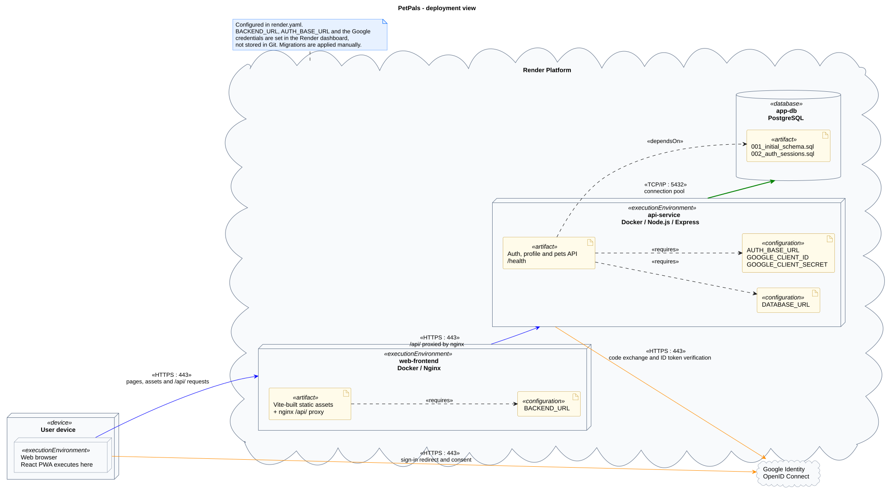

# 6. Deployment, Installation, and Configuration

**Objective:** Show where the application runs, how its deployed parts communicate, and how a reader can install, configure, deploy, and maintain it. The [README](../README.md) gives the public address and the shortest local Quick Start; this page adds the setup details needed to reproduce the application.

## 6.1 Deployment View

**Objective:** Identify the running environments, deployed software, data store, and relevant external services. Show communication between them in one UML deployment diagram. A component diagram explains logical responsibilities; this diagram explains where the executable parts run.

PetPals is designed as one React Progressive Web Application for Pet Owners, Pet Helpers, and Administrators. The implemented frontend is built with React, React Router, and Vite; the Node.js/Express backend provides the current authentication and registration, self-profile and pets APIs; PostgreSQL stores the application schema and authentication sessions. Google Identity supplies OpenID Connect authentication. Payment processing is outside project scope.

The version-controlled [`render.yaml`](../render.yaml) defines these hosted parts:

| Deployment node / service | Runtime or role | Connection |
| --- | --- | --- |
| User's browser | Executes the React frontend and sends API requests | HTTPS to the frontend only; /api/ requests go through the frontend's nginx |
| Render frontend service, `web-frontend` | Docker-built Vite assets served by Nginx | Delivers static files and React Router history fallback, and forwards /api/ to the backend |
| Render backend service, `api-service` | Node.js/Express in Docker; `PORT` set by hosting platform | Handles /health, /api/auth/*, /api/users/me, /api/pets and example routes |
| Render PostgreSQL database, `app-db` | Managed PostgreSQL (`appdb`, database user `dbuser` in declared blueprint) | Private database connection from the backend; not directly from browser |
| Google Identity | External OAuth 2.0/OpenID Connect provider | Browser authorization redirect and backend callback; provider is not hosted by PetPals |

**Deployment diagram:**



PlantUML source: [`puml/6-1-deployment.puml`](puml/6-1-deployment.puml).

**Actual vs. planned:** Authentication sessions, self-profile retrieval, profile updates and photo processing have code on `main`. The React client includes login, registration, profile, My pets (saved to PostgreSQL through /api/pets) and an empty My listings page. Maps, Google Calendar synchronization, bookings, confirmations, reviews and the administrative UI are planned. There is **one frontend application**, with different views based on role, not three separately deployed applications.

**Public address:** The application runs at https://petpals-frontend.onrender.com/ and the backend API at <backend URL>. The free Render plan puts services to sleep, so the first request after a pause can take about a minute.

**How the browser reaches the API:** The browser opens only the frontend address. In production nginx ([`frontend/nginx.conf.template`](../frontend/nginx.conf.template)) serves the React files and forwards every `/api/` request to the backend (the target is `BACKEND_URL` of `web-frontend` in [`render.yaml`](../render.yaml)). Locally the Vite dev server ([`frontend/vite.config.js`](../frontend/vite.config.js)) does the same for `http://localhost:10000`. Because the page and the API share one origin, the session cookie and the CSRF check work. After Google sign-in a returning user lands on `/profile` and a new user on `/register`.

## 6.2 Installation and Local Configuration

**Objective:** Enable a reader to install and run the complete application from a clean checkout, including services and data that a short README Quick Start cannot explain fully.

The procedure below uses a local Node.js backend and Vite frontend plus a PostgreSQL container. More detail is in [backend/README.md](../backend/README.md), [Google sign-in](../backend/docs/google-auth.md) and [frontend/README.md](../frontend/README.md).

### 6.2.1 Prerequisites and source code

Install Git, Node.js and npm compatible with the versioned lockfiles, PostgreSQL 15 or a compatible version, and a PostgreSQL command-line client (`psql`) or Docker Engine with Docker Compose. Use Node.js 20 or newer (the Dockerfiles use Node.js 20).

For a real Google sign-in test, obtain a Google Cloud **Web application OAuth client** in an authorized team project. The team provides the client ID and secret privately; never commit them.

From a terminal, clone the repository and check the revision:

```bash
git clone https://github.com/xikodev/PetPals.git
cd PetPals
git checkout main
git pull --ff-only
git rev-parse --short HEAD
```

The following paths assume the terminal is at **the repository root** unless a `cd` command is shown.

### 6.2.2 Database selection and migrations

**Shared database:** A teammate can run the backend locally against the Render PostgreSQL service with an untracked backend/.env (DB_SSL=true). Ask the database maintainer for the values; never copy them into Git, documents, screenshots or logs, and do not run migrations or tests that change data there without the maintainer's agreement.

**Recommended isolated test setup:** The Docker commands below deliberately create a different, disposable *local* database. They should not be run against the shared Render database. In `backend/.env`, choose either the local Postgres values with `DB_SSL=false`, or the approved Render connection settings with TLS; do not mix them. For isolated automated tests, prefer local Postgres even if the developer normally connects to Render.


For the repository's development Docker Compose setup, start **only PostgreSQL** initially:

```bash
docker compose up -d db
docker compose ps
```

The Compose file configures a PostgreSQL 15 container, a local database named `appdb`, and a development account `dbuser`. Its sample password is **for isolated local development only**; replace shared/default credentials for any exposed or hosted environment. Wait for the database to become healthy. To inspect an already initialized database:

```bash
docker compose exec db psql -U dbuser -d appdb -c '\dt'
```

For a **fresh empty database only**, apply these migrations in order. They are not automatically run when the backend starts:

```bash
docker compose exec -T db psql -U dbuser -d appdb < backend/migrations/001_initial_schema.sql
docker compose exec -T db psql -U dbuser -d appdb < backend/migrations/002_auth_sessions.sql
docker compose exec db psql -U dbuser -d appdb -c '\dt'
```

Alternatively, for a separately managed local PostgreSQL instance with a previously created `dbuser` and `appdb`:

```bash
psql -h localhost -U dbuser -d appdb -v ON_ERROR_STOP=1 -f backend/migrations/001_initial_schema.sql
psql -h localhost -U dbuser -d appdb -v ON_ERROR_STOP=1 -f backend/migrations/002_auth_sessions.sql
```

The alternative assumes that the role/database already exist and has schema privileges; creating a PostgreSQL role/database requires an administrator and is installation-specific. **Do not rerun migration 001** on an existing initialized PetPals database. If only migration 002 is missing, apply only 002. Verify `auth_sessions` exists, and preserve production data by running migrations through a reviewed backup/change procedure. Do not use a production database for testing.

### 6.2.3 Backend configuration and startup

Copy the backend's safe example configuration to a local, uncommitted file:

```bash
cp backend/.env.example backend/.env
```

Edit `backend/.env` (never commit real credentials). These are the relevant variable names from the repository:

| Variable | Purpose / safe local example |
| --- | --- |
| `PORT` | Backend listening port, normally `10000` |
| `DB_HOST` | `localhost` when running Node.js on the host and PostgreSQL through published Compose port |
| `DB_PORT` | `5432` for the local Compose database |
| `DB_USER` | Local application PostgreSQL role, e.g. `dbuser` |
| `DB_PASSWORD` | Local database password; **secret** |
| `DB_NAME` | Local database name, e.g. `appdb` |
| `DB_SSL` | `false` for a trusted local PostgreSQL setup; configure hosted TLS according to provider policy |
| `DATABASE_URL` | Optional connection-string alternative; if used, contains credentials and is **secret** |
| `AUTH_BASE_URL` | Local backend origin `http://localhost:10000` with no path |
| `GOOGLE_CLIENT_ID` | OAuth Web client identifier from Google Cloud |
| `GOOGLE_CLIENT_SECRET` | OAuth Web client secret; **secret** |

 Avoid configuring conflicting `DATABASE_URL` and `DB_*` values; the backend code gives the connection string precedence. In Google Cloud, configure the OAuth consent screen, allow the relevant test accounts when consent is in testing mode, and add the authorized redirect URI:

```
http://localhost:10000/api/auth/google/callback
```

In a terminal at the repository root, run:

```bash
cd backend
npm ci
npm run db:check
npm test
npm start
```

The backend should listen at `http://localhost:10000` if configuration and database checks succeed. Keep the process running for browser testing. Test in a separate terminal:

```bash
curl -i http://localhost:10000/health
curl -i http://localhost:10000/api/auth/me
```

Expected behavior: `/health` should return a successful health JSON response; `/api/auth/me` without a session should return an authentication-related response, not a proxy/network error. Google sign-in starts when the user selects "Sign in with Google" in the frontend, which forwards /api/auth/google to the backend. Google returns to the backend callback. A returning user lands on /profile; a new user lands on /register, chooses a role (owner or helper), enters a first and last name, and is then taken to /profile with the verification status "pending".

For a full implemented route list, request bodies, response JSON, status and error codes, see [API reference](../backend/API.md). For detailed authentication constraints and examples see [Google sign-in](../backend/docs/google-auth.md), [User profile](../backend/docs/user-profile.md), and [User settings](../backend/docs/user-settings.md), [Pets](../backend/docs/pets.md). The protected `GET /api/users/me` and `PATCH /api/users/me` routes require an authenticated test session; state-changing requests additionally require the documented Origin and CSRF token. New owner/helper accounts require administrator approval before booking access.

### 6.2.4 Frontend configuration, startup and quality checks

Open a **second terminal** from the repository root:

```bash
cd frontend
npm ci
npm run lint
npm run build
npm run dev
```

Open Vite's displayed development URL, normally `http://localhost:5173`. The frontend has the pages home, /login, /register, /profile, /my-pets and /my-listings. Profile and My pets use the backend and are stored in PostgreSQL; My listings is an empty page.

The Vite development proxy forwards requests with the `/api` prefix to port 10000. To check guest routing without a Google test account, create an uncommitted `frontend/.env.local` containing:

```dotenv
VITE_MOCK_GUEST=true
```

Restart `npm run dev` after changing Vite environment files, and navigate directly to `/profile` and `/my-listings`; both should redirect a guest to `/login`. Remove this setting or set it to `false` when testing real authentication. This is a frontend route-guard check, **not proof of backend session functionality**.

For actual client-to-backend communication, use browser developer tools to inspect the request to `/api/auth/me`, including its status, content type, and the Vite proxy. A `401` from the backend for an anonymous request can be an expected result; a network error, HTML fallback or proxy failure is not. For data persistence, use an approved **isolated** test account to update an allowed profile field and then retrieve the profile again; do not use shared production users. The Vite development proxy rewrites the Origin header, so the backend's CSRF check accepts requests from http://localhost:5173. Also verify profile-photo uploads: the users PATCH route has a `512kb` JSON parser and photo-data validation of at most 350000 characters; the `16kb` parsers in `app.js` are mounted on other API prefixes.

### 6.2.5 Troubleshooting and local acceptance criteria

| Symptom | Check |
| --- | --- |
| Backend refuses to start | Confirm PostgreSQL health, `DB_*` or `DATABASE_URL`, migration state, `AUTH_BASE_URL` and required Google settings; inspect backend console output |
| `npm run db:check` fails | Confirm DB port/account/password and that the database exists; use `docker compose ps` and PostgreSQL logs |
| OAuth sign-in fails | Verify callback URI matches Google Cloud settings exactly, `AUTH_BASE_URL`, allowed test accounts, and backend logs; never log tokens or client secrets |
| Browser `/api/*` returns frontend HTML | Check Vite proxy in local dev or the nginx proxy (frontend/nginx.conf.template) and the BACKEND_URL setting of web-frontend |
| Profile-photo PATCH returns 413 | The users PATCH route has a `512kb` JSON body limit, which returns HTTP 413 when exceeded. A `photo_data` string over 350000 characters instead fails validation with HTTP 400; the auth/examples `16kb` parsers do not apply to this route. |
| Node/Vite build fails | Use a Node/npm combination compatible with the current lockfiles and record exact build error |

**A local installation is verified only when** PostgreSQL is initialized, the backend health endpoint works, frontend lint/build complete, Vite serves the app, a client request reaches the API, and the required authenticated profile/persistence tests pass in a controlled environment. The results are recorded in [Section 5](5-Testing.md).

## 6.3 Public Deployment and Administration

**Objective:** Enable a reader to reproduce the **public** application from the repository, including the hosted database and connections among deployed parts.

### 6.3.1 Hosting and build configuration

[`render.yaml`](../render.yaml) defines one PostgreSQL database and two Docker-backed Render web services. The backend's [`Dockerfile`](../backend/Dockerfile) uses Node.js 20 in production mode and starts `npm start`; the frontend's [`Dockerfile`](../frontend/Dockerfile) builds the Vite application and serves its `dist` output with Nginx. [`frontend/nginx.conf.template`](../frontend/nginx.conf.template) serves the React app with SPA fallback and forwards /api/ to the backend. 

The hosted backend uses Render's assigned `PORT`, the connection string of `app-db`, an HTTPS `AUTH_BASE_URL` (see 6.3.2) and the team's Google OAuth Web client settings. It exposes a `/health` endpoint, which the blueprint references for health checking. The database migrations do not run automatically at startup; `001_initial_schema.sql` and `002_auth_sessions.sql` were applied manually to the Render database.

### 6.3.2 Required hosted settings and secrets

| Service | Required setting | Handling |
| --- | --- | --- |
| Render PostgreSQL | Database name, role and database connection URL | Obtain from Render; do not publish credentials |
| Backend | `DATABASE_URL`, `PORT` (host-provided), and any required SSL configuration | Store securely in Render service environment; never embed database secrets in frontend |
| Backend | AUTH_BASE_URL=https://petpals-frontend.onrender.com` | The address users open (the frontend), because nginx forwards /api/ including the Google callback. It must equal the browser's Origin (CSRF check) and the origin of the redirect URI registered in Google Cloud |
| Backend | `GOOGLE_CLIENT_ID`, `GOOGLE_CLIENT_SECRET` | From team's authorized Google Cloud OAuth client; client secret is private |
| Frontend (web-frontend) | BACKEND_URL=https://<backend-host> | Address of the backend; nginx forwards /api/ to it |
| GitHub Actions CD | `RENDER_DEPLOY_HOOK_URL`, if automatic redeployment via webhook is enabled | Repository secret; if absent, the workflow prints a skip message |

The web-frontend service needs BACKEND_URL, the address of the backend service; nginx uses it as the target for /api/ (set in render.yaml). The frontend code calls relative /api paths and needs no VITE_* variable.

### 6.3.3 Deployment procedure

1. In Render, confirm which repository/branch is connected to `app-db`, `api-service`, and `web-frontend` (see [`render.yaml`](../render.yaml)). Compare the **actual** dashboard configuration with the version-controlled blueprint.
2. Provision or inspect managed PostgreSQL. On a *new empty* database, apply [`001_initial_schema.sql`](../backend/migrations/001_initial_schema.sql) and [`002_auth_sessions.sql`](../backend/migrations/002_auth_sessions.sql) in that order through an authorized secure SQL connection or approved migration mechanism. Check schema and permissions; never rerun initial schema on populated databases.
3. Set the backend's environment settings in Render and configure the exact HTTPS Google callback URL in Google Cloud: `https://<actual-backend-host>/api/auth/google/callback`.
4. Deploy the backend image; confirm startup logs and `GET https://<actual-backend-host>/health`. Check authentication errors without exposing session cookies, database URLs, or tokens.
5. Set BACKEND_URL on web-frontend to the backend's address. Open the frontend address and sign in: a returning user lands on /profile, a new user on /register.
6. Deploy the frontend image, verify its actual public address, load `/`, test SPA reload of `/profile`, and complete the sign-in and profile checks with an authorized test account. Capture browser network evidence that the request reaches the correct backend.
7. Record the deployed Git revision, URLs, migration version, and smoke-test results in [Testing](5-Testing.md). Do not claim deployment complete based solely on a Render dashboard green indicator or static home page.

**Current public status:** Checked on 17.11.26.: frontend and Google sign-in work on the public address (see DEP-01 and REG-01 in [5.2](./5-Testing.md#52-test-cases)). Migrations 001 and 002 were applied manually to the Render database.

### 6.3.4 Administration, monitoring and maintenance

The data model includes an administrator role, but administrator sign-up, an initial administrator account and the administration screens are not implemented yet (planned for the next cycle). Administrator credentials are never published.

Operational checks available from the versioned project include the backend `/health` endpoint, Render service logs/events, PostgreSQL connection diagnostics, and GitHub Actions workflow history. The CI workflow currently **does not** execute backend unit tests or frontend lint/build; it echoes a message. The CD workflow posts to a Render deploy hook on pushes to `main` **only if** its secret exists; otherwise it skips.

For a production update, review the PR and relevant test evidence, back up production data using an approved policy, inspect pending schema changes, deploy through the authorized team procedure, and run a health and browser smoke test. A backup, restore or rollback procedure beyond Render's own features is not defined yet. Authentication session expiry is implemented, while regular database cleanup of expired session rows is described as potential future housekeeping, not a confirmed scheduled job.

**Known gaps:** no administrator provisioning, no defined backup and restore procedure, and no automated tests in CI (see [5.4](5-Testing.md#54-known-defects-and-testing-limits)).
